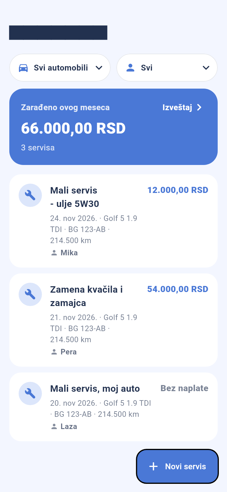
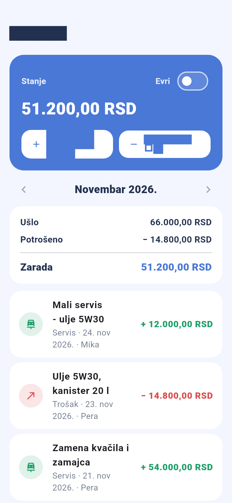
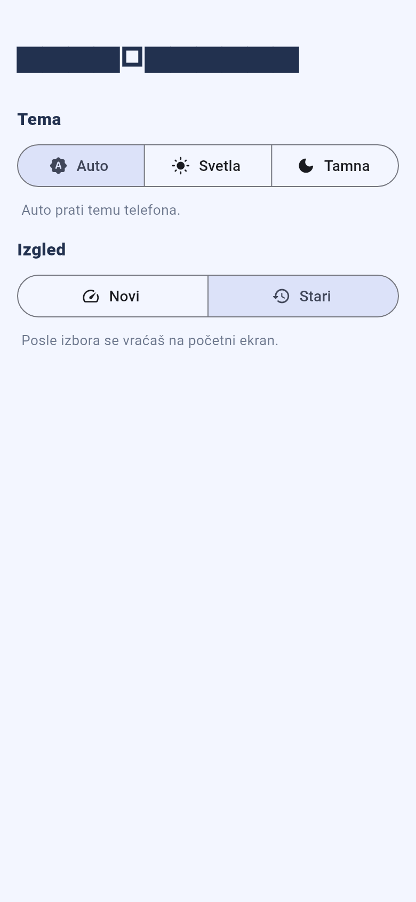

# The classic interface

The app has two whole interfaces over the same data. A phone shows one of
them; which one is chosen in Settings under "Izgled" ("Novi" or "Stari") and
kept on that phone. A phone starts on the new one.

- **New** ("Novi"): the leaning interface, in `lib/screens/`, `lib/widgets/`
  and `lib/theme/`. Every other page in this folder describes it.
- **Classic** ("Stari"): the interface as it was in 1.12.3, the last release
  before 2.0, in `lib/classic/screens/`, `lib/classic/widgets/` and
  `lib/classic/theme/`. This page is all there is about it.

## What the classic one is

The same screens, the same texts and the same actions as the new one, drawn
and arranged the way they were:

- A shell with **two tabs**, "Servisi" and "Kasa", an app bar with the tab's
  name and the search by plate, and a **drawer** opened from the app bar. The
  drawer lists, in order: "Servisi", "Kasa", "Kalendar", "Mesečni izveštaj",
  "Pretraga po tablicama", "Automobili", "Alat", "Za kupovinu", "Tutorijali",
  "Korisnici" (admin only), "Podešavanja", and at the bottom "Odjavi se". The
  calendar is a pushed screen there, not a tab.
- Lists are **cards** with rounded corners (radius 20) and gaps between them,
  on a ground tinted with the chosen color.
- The system typeface, round buttons and pills, Material switches.
- Its own six shades of the same six colors. The color is chosen once and
  serves both interfaces, each in its own shade; until someone chooses, the
  classic one is in its blue and the new one in its red.

What it shares with the new one, because both run in the same app: the
models, the repositories and `LiveData`, the texts, the money formatting, the
light, dark or auto theme, the "Evri" switch, and Serbian in Latin script.

The pictures are put together from the classic widgets with made-up data, as
the others are; the app bar titles come out as blocks because the picture
script does not load that weight of the system typeface.

## How the choice works

- `lib/services/ui_choice.dart` holds it (`uiChoice`, stored as `ui_style`).
- `lib/main.dart` gives `MaterialApp` the chosen interface's theme, and its
  first screen is the chosen interface's `AuthGate`. Each interface has its
  own gates, shell and screens; nothing below the gates is shared.
- Choosing the other one in Settings closes every open screen and draws the
  app again from the first screen, with a fresh `LiveData`.

## The rule

**A change to what a screen does or shows is made in both interfaces**, in
the same commit: in `lib/screens/` or `lib/widgets/`, and in the file of the
same name under `lib/classic/`. A change of look alone belongs to one of
them. Tests for the classic widgets are in `test/classic/`, under the same
file names as the tests of the new ones.
