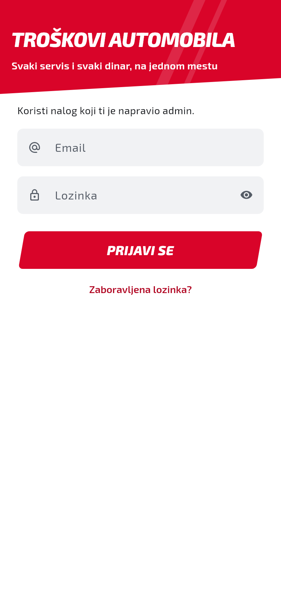

# Before the shell: login, admin claim, status and the gates

Code: `lib/screens/auth_gate.dart`, `lib/screens/profile_gate.dart`,
`lib/screens/login_screen.dart`, `lib/screens/claim_admin_screen.dart`,
`lib/screens/status_screen.dart`,
`lib/widgets/email_autocomplete_field.dart`.

---

## The gates

Two widgets that decide what to show and draw nothing of their own except a
centered spinner while they wait.

- **AuthGate:** signed in? If not, the login screen.
- **ProfileGate:** does the account have a profile, and is it enabled?

| Situation | What shows |
|---|---|
| Profile found and enabled | the [shell](shell.md) |
| No admin exists yet | the admin claim screen |
| Account disabled | status screen: a block icon, "Nalog onemogućen", "Admin je onemogućio ovaj nalog." |
| No profile, still checking | status screen: an hourglass icon, "Završavam podešavanje", a spinner |
| No profile, no access | status screen: a lock icon, "Nema pristupa", "Ovaj nalog nije registrovan u aplikaciji. Zamoli admina da te doda." |
| An error | status screen: a cloud-off icon, "Nešto nije u redu. Pokušaj ponovo.", the error text |

Switching accounts resets everything below the gates.

---

## Login

### Purpose

Sign in with the email and password the admin handed out.

**Opens from:** AuthGate, when nobody is signed in.

### What it shows

1. **Header**, the accent block, with no back arrow:
   - "Troškovi automobila" as the title (shown in capitals);
   - under it "Svaki servis i svaki dinar, na jednom mestu".
2. "Koristi nalog koji ti je napravio admin."
3. **"Email"**, with an @ icon. Emails used before are offered under it.
   Error: "Unesi ispravan email".
4. **"Lozinka"**, with a lock icon and an eye that shows or hides it. Error:
   "Najmanje 6 karaktera".
5. **"Prijavi se"** (shown in capitals).
6. A text button **"Zaboravljena lozinka?"**.

### Actions

| Tap | Result |
|---|---|
| A saved email | fills the field and moves the cursor to the password |
| The x beside a saved email (tooltip "Obriši") | forgets it |
| The eye | shows or hides the password |
| "Prijavi se" | signs in; reads "Sačekaj..." meanwhile |
| "Zaboravljena lozinka?" | sends a reset email to the address in the field |

### Messages

Snack bars: "Poslat je email za promenu lozinke.", "Unesi ispravan email", and
sign-in errors such as "Pogrešan email ili lozinka.", "Ovaj nalog je
onemogućen." and "Nema internet konekcije."

### Layout today

- From the top: the header, then the form, which scrolls.
- Header: the title bar, then the tagline in w600, in `onPrimary`.
- Form: padding 24, 12, 24, 24, items stretched to full width. The hint; 16;
  the email; 14; the password; 24; the button; 4; the text button.
- "Prijavi se" is the leaning button, 52 high, label 18, without an icon,
  with 6 kept free at each end. While it waits it is drawn at half opacity.
- Saved emails: a popup with elevation 6, radius 8, at most 260 high; each
  row has a history icon, the email and the x.

---

## Admin claim

### Purpose

The one-time step that makes the first account the admin. It works exactly
once; afterwards the role is locked.

**Opens from:** ProfileGate, while no admin exists.

### What it shows

No header.

1. A shield icon.
2. "Postani admin".
3. "Admin još ne postoji. Unesi ime i prezime; tvoj nalog postaje admin i
   moći će da dodaje druge korisnike."
4. **"Ime"** and **"Prezime"**, both required ("Obavezno").
5. **"Postani admin"** (shown in capitals). It reads "Sačekaj..." while it
   works: this screen waits for the answer. A failure shows as a snack bar.
6. A text button **"Odjavi se"**.

### Layout today

- Background: the plain `background` color. Padding 28, centered on the
  screen, stretched, scrolling when it does not fit.
- Icon 72 px in `primary`; 20; the title centered in 24 w800; 12; the body
  centered; 24; the two fields 12 apart; 24; the button; 4; the text button.
- The button is the leaning one, 52 high, label 18, without an icon.

---

## Status screen

### Purpose

One message, full screen, for when the app cannot go on: no access, a
disabled account, still setting up, or an error. The four cases are in the
table under "The gates".

### What it shows

No header.

1. An icon.
2. A title.
3. A body text, or a spinner while something is still loading.
4. A text button **"Odjavi se"**.

The screen can also take a leaning button above "Odjavi se"; nothing uses it
at present.

### Layout today

- Background: the plain `background` color. Content centered on the screen,
  padding 28.
- Icon 72 px in `primary`; 20; the title centered in 24 w800; 12; the body
  centered; 28; then the buttons, 8 apart when there are two.
