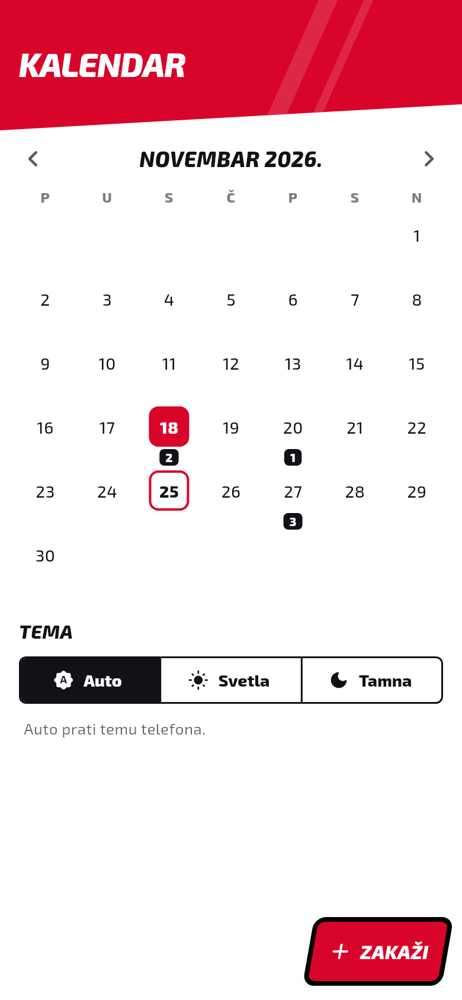

# Calendar

Code: `lib/screens/calendar_screen.dart`, `lib/widgets/month_grid.dart`,
`lib/widgets/appointment_dialog.dart`.

## Purpose

Bookings by day: free text such as which car, whose, and at what time.
Everyone sees every booking.

**Opens from:** the shell's third tab; "Kalendar" in the bottom bar.

## What it shows

Header: "Kalendar" (shown in capitals). As a tab it has no back arrow.

1. The **month switcher**, from the earliest month with a booking to the last
   month that can be booked (December of next year).
2. The **month grid**: a row of weekday letters, then the days in weeks,
   starting on the locale's first day of the week (Monday in Serbian).
   - The selected day is a filled box in the accent; today has an outline in
     the accent.
   - A day with bookings has a small dark block with their number under it.
3. The **selected day** as a heading, for example "sreda, 25. novembar"
   (shown in capitals).
4. One **booking row** per booking of that day, in the order they were
   written: the text, then a person icon and the name of whoever entered it.
5. **Floating button:** "Zakaži" (shown in capitals).

The picture shows the switcher and the grid of this screen, with the 18th
selected and the 25th as today. The "Tema" chooser under the grid is not on
this screen; it is the one from [Settings](settings.md), drawn into the same
picture. The day heading and the booking rows are not in the picture.

## Actions

| Tap | Result |
|---|---|
| The arrows | the month before / after; the first day of that month is selected, or today in the current month |
| A day | selects it; the heading and the rows follow |
| "Zakaži" | the booking dialog for the selected day |
| A booking row | the booking dialog for it: editable for its author and the admin, read-only for others |

Leaving the tab and coming back returns to today.

## Dialogs

**Booking dialog.** Title "Novo zakazivanje" for a new one, "Zakazano" for an
existing one. A delete icon (tooltip "Obriši") in the title row for whoever
may change it.

- "Datum", a date field with the month written out.
- "Šta je zakazano", 2 to 5 lines, up to 500 characters, hint
  "npr. Opel Astra, Mika, 10h". Required ("Obavezno").
- Existing booking: a person icon and "Uneo/la: {name}", or
  "Ovo mogu da menjaju samo {name} ili admin."
- Buttons: "Otkaži" and "Sačuvaj"; for someone who may only look, just
  "Zatvori".
- Delete asks "Obrisati ovo zakazivanje?".

Adding a booking sends a push to every active account. Deleting one that
people were told about sends one too.

## States

- **Loading:** a spinner. **Error:** the error text, padding 48/24. Both show
  under the header; this screen does not wait for the shell's data.
- **A day with nothing:** "Za ovaj dan nema ničeg zakazanog."

## Layout today

- From the top: the header (82 plus the status bar), then one scrolling
  list. The list has no side padding and 96 at the bottom.
- Switcher: 4 at the sides. Grid: 12 at the sides.
- Weekday letters: shown in capitals, 12 w700, `ink` at 0.55; 4 under them.
- Day cell: 54 high. The number sits in a 34×34 box with radius 8: selected
  is filled with `primary` and written in `onPrimary` w800; today has a 2 px
  border in `primary` and w800; other days are w500 in `ink`.
- Booking-count block: 2 under the box, 14 high, `ink` fill, radius 4,
  horizontal padding 5, the number in 10 w800 in `background`. Its space is
  kept even on an empty day, so rows do not jump.
- Day heading: 16 italic w800, padding 16, 12, 16, 8, with a hairline under
  it.
- Booking row: edge to edge with a hairline under it, padding 16, 10, 16, 10;
  the text in 15 w600, as many lines as it needs; 4; a 14 px person icon and
  the name in 13, both `muted`.
- Empty text: centered, 24 vertical and horizontal.
- In the dialog: 12 between the date and the text, and 12 above the author
  line.
- The sync banner is the shell's, above the bottom bar; this screen draws
  none of its own.
