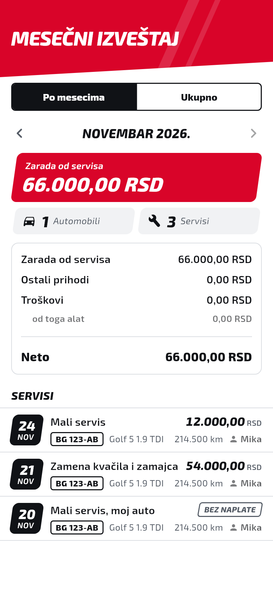

# Monthly report

Code: `lib/screens/report_screen.dart`, `lib/widgets/report_view.dart`,
`lib/widgets/money_row.dart`, `lib/models/report.dart`.

## Purpose

What the workshop did, took in and spent, for one month or over all time. A
month also lists its services, since the Services tab shows only the current
one. It stays live while open.

**Opens from:** "Mesečni izveštaj" on the [Više tab](shell.md); the earnings
in the header of the [Services tab](services.md).

## What it shows

Header: "Mesečni izveštaj" (shown in capitals), with a back arrow. Under it,
the sync banner.

1. A segmented switch **"Po mesecima" | "Ukupno"**. It opens on "Po mesecima"
   and stays in place while the rest scrolls.
2. By month only: the **month switcher**, from the month of the oldest record
   (service, wallet entry or tool) to the current month.
3. A leaning block in the accent: **"Zarada od servisa"** and the amount, one
   line per currency.
4. Two leaning tiles side by side: the number of **"Automobili"** (different
   cars that came in) and of **"Servisi"**, each with an icon.
5. A card of money rows:
   - "Zarada od servisa"
   - "Ostali prihodi"
   - "Troškovi", with a minus
   - "od toga alat", a smaller detail row
   - a divider
   - "Neto", the bottom line; red when negative
6. By month only: the heading **"Servisi"** (shown in capitals) and one
   [service row](services.md) per service of that month.

In the picture the segmented switch spans the full width and is part of the
scrolling list. On the screen it is only as wide as its two labels, centered,
and stays in place.

What the numbers mean:

- **"Zarada od servisa"** counts every service, whether or not its money went
  into the wallet. A service with no charge counts as a service and a car but
  adds nothing.
- **"Ostali prihodi"** are deposits into the wallet.
- **"Troškovi"** are wallet spending plus tools paid outside the wallet.
- **"od toga alat"** is the part of the costs that went on tools.
- **"Neto"** is the first two less the costs.
- Dinars and euros are separate lines everywhere; they are never added.

## Actions

| Tap | Result |
|---|---|
| "Po mesecima" / "Ukupno" | one month, or everything since the first record |
| The arrows | the month before / after |
| A service row | the [service form](services.md) |

## States

- **Loading:** a centered spinner until the main data and the tools have
  arrived. This screen waits for tools because tool spending is in the costs.
- **Error:** the error text, centered, padding 48/24.
- **A month without services:** "Tog meseca nije bilo servisa." under the
  heading. The blocks above still show, with zeros.
- **"Ukupno":** no month switcher and no list of services.

## Layout today

- From the top: the header, the sync banner, the segmented switch (as wide as
  its labels, centered, padding 16, 4, 16, 4, no check icon), then one
  scrolling list with no side padding and 32 at the bottom.
- Switcher: 4 at the sides.
- The blocks and the card: 16 at the sides and 4 above; the two kinds of
  leaning block are set in by 4 more, so that their lean stays on screen.
- Earned block: leaning 8°, `primary` fill, radius 8, padding 14, 9, 14, 11;
  the label in 13 w600; the amounts in 28 italic w800, shrinking to fit;
  everything in `onPrimary`.
- 8; the two count tiles share the row equally, 8 apart: leaning 8°, `panel`
  fill, radius 8, padding 12/8; a 20 px icon (a car, a wrench) in `ink`; 8;
  the number in 22 w800; 6; the label in 13 `muted`, on one line.
- 12; the money card: a card with a hairline border and radius 10, padding
  14, 8, 14, 10; rows as in MoneyRow (see [shared.md](../shared.md)); the
  divider takes 24 of height. "Neto" is in `ink`, not in the accent, and in
  `moneyOut` when negative.
- The "Servisi" heading: 16 italic w800, padding 16, 18, 16, 6, then a
  hairline. Service rows touch. The empty text has 24 vertical and horizontal
  padding.
