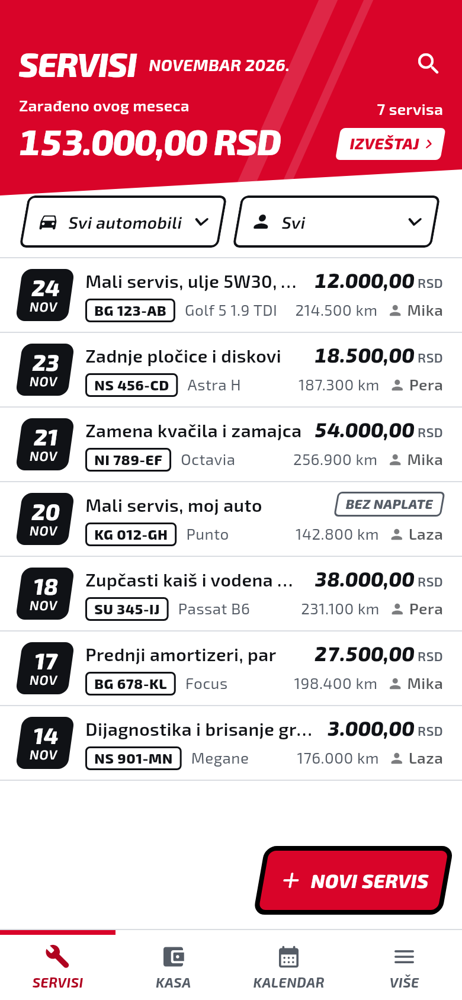
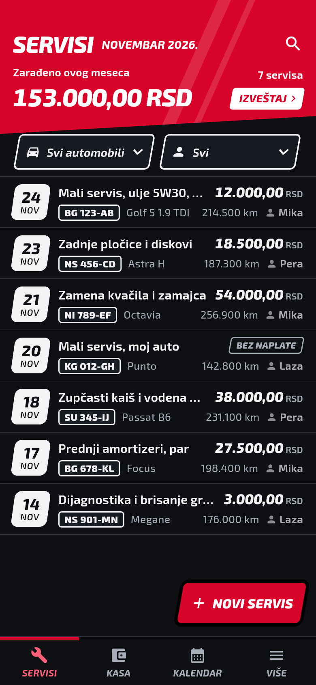
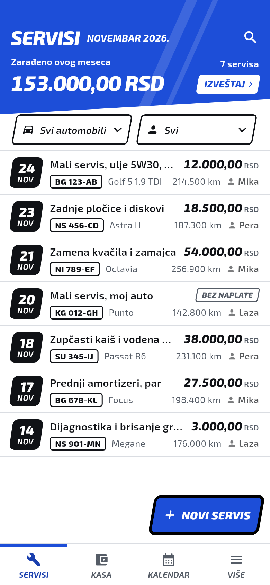
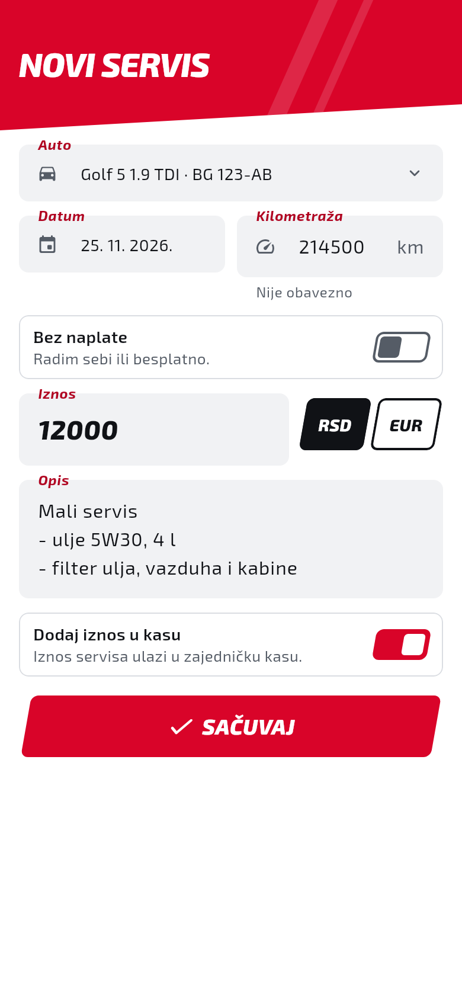

# Services: the tab, the form and the row

Code: `lib/screens/services_tab.dart`, `lib/screens/repair_form_screen.dart`,
`lib/widgets/repair_card.dart`, `lib/widgets/earnings_card.dart`,
`lib/widgets/repair_price_fields.dart`, `lib/widgets/filter_pill.dart`,
`lib/widgets/date_block.dart`, `lib/widgets/plate_chip.dart`.

---

## Services tab

### Purpose

This month's services from every user, with what they earned, filterable by
car and by person. Earlier months are in the [report](monthly-report.md) and in each
car's [history](vehicles.md).

**Opens from:** the shell's first tab; "Servisi" in the bottom bar. The app
opens on it.

### What it shows

1. **Header:**
   - the title "Servisi" and after it the current month, such as "novembar
     2026." (both shown in capitals);
   - a search icon, tooltip "Pretraga po tablicama";
   - the **earnings**: "Zarađeno ovog meseca" and under it the sum of the
     services listed below, one line per currency; at the right end "N
     servisa" and under it a leaning chip "Izveštaj" (shown in capitals) with
     a chevron.
2. **Two filter buttons** side by side:
   - Car: a car icon and "Svi automobili", or the plate (the name if there is
     no plate) of the chosen car.
   - Person: a person icon and "Svi", or the chosen person's name.
3. **One service row per service** of the current month that passes the
   filters, newest first. See "Service row" below.
4. **Floating button:** "Novi servis", or "Dodaj auto" while there are no
   cars (shown in capitals).

### Actions

| Tap | Result |
|---|---|
| Search icon | opens [vehicle search](vehicles.md) |
| The earnings, anywhere on them | opens the [report](monthly-report.md) |
| Car filter | option sheet titled "Auto": "Svi automobili", then every car with "N servisa" (this month's count) |
| Person filter | option sheet titled "Osoba": "Svi", then every user with "N servisa" |
| The x on an active filter | clears that filter |
| A service row | opens the service form: editable for its author and the admin, read-only for others |
| "Novi servis" | opens an empty service form, with the filtered car already chosen |
| "Dodaj auto" | opens the car dialog (see [vehicles](vehicles.md)) |

Both filters change the list, the sum and the count in the header.

### States

- **No cars yet:** "Dodaj auto pre nego što dodaš servis."
- **No services at all:** "Još nema servisa.\nDodirni + da dodaš prvi."
- **None this month, or none that pass the filters:** "Ovog meseca još nema
  servisa.\nRaniji su u mesečnom izveštaju."
- Loading and errors are handled by the [shell](shell.md).
- Leaving the tab and coming back clears both filters.

### Layout today

- From the top: the header, the row of filters, a hairline, the list.
- Header: the title bar with the title, the month and the search icon; under
  it the earnings. On the left the label in 13 w600, 4, then the amounts in
  30 italic w800, shrinking to fit; on the right, bottom-aligned, the count
  in 13 w600, 6, then the chip. Everything is in `onPrimary`.
- "Izveštaj" chip: leaning, filled with `onPrimary`, radius 4, padding
  10, 4, 4, 4; the text in 13 w800 and a 16 px chevron, both in `primary`.
- Filters: directly under the header, padding 20, 0, 22, 8; the two share
  the row equally, 12 apart; each 44 high (see [shared.md](../shared.md)).
- List: no side padding, 96 at the bottom; rows touch.
- Floating button: 50 high, label 16, a plus icon, lifted by 4.
- Empty-state text: centered, padding 48 vertical, 24 horizontal.

---

## Service row

Used on the Services tab, in the report's list and in a car's history.

### What it shows

- A **date block**: the day over the short month.
- The description on one line. A description written on several lines is
  joined with commas, and dashes or bullets at the start of a line are
  dropped: "Mali servis", "- ulje 5W30", "- filteri" shows as "Mali servis,
  ulje 5W30, filteri".
- On the right: the amount, or a leaning tag **"Bez naplate"** (shown in
  capitals) for a service with no charge.
- Under them, on one line: the plate drawn as a plate, the car's name, the
  mileage in km, and a person icon with the first name of whoever entered it
  (the full name is in the form). The mileage is left out when none was
  entered. In a car's own history the plate and the car's name are left out,
  and the mileage starts the line in their place.

### Layout today

- Edge to edge with a hairline under it; padding 16 at the sides, 8 above
  and below. The date block is 44×44; 12; then the two lines of text.
- First line: the description in 15 w600, cut with an ellipsis; 10; the
  amount in 17 italic w800 with the currency smaller after it, or the tag.
- 5 between the lines.
- Second line: the plate (12 w800 in its box); 8; the car's name in 13
  `muted`, which takes the room that is left and is cut with an ellipsis
  before the mileage is; 8; the mileage in 13 `muted`; 8; a 14 px person icon
  in `ink` at 0.55; 3; the author's first name in 13 w600, `ink` at 0.7, at
  most 72 wide. The icon and the author stay at the right end.
- In a car's own history the second line is the mileage at the left, in 13
  `muted`, then the icon and the author at the right end.

---

## Service form

### Purpose

Enter a service, or view, change or delete one.

**Opens from:** "Novi servis" on the Services tab and in a car's history; any
service row; a service line in the [wallet](wallet.md).

### What it shows

Header: "Novi servis" or "Izmena servisa" (shown in capitals), with a back
arrow; a delete icon (tooltip "Obriši") for an existing service its viewer
may change.

1. Existing service only: a person icon and "Uneo/la: {name}", or for someone
   who may only look, "Ovo mogu da menjaju samo {name} ili admin."
2. **"Auto"**: a picker field with a car icon.
3. On one line:
   - **"Datum"**: a date field showing digits only, such as "25. 11. 2026.";
     today for a new service.
   - **"Kilometraža (km)"**: a number field with a gauge icon, helper
     "Nije obavezno". Error: "Unesi ceo broj".
4. **"Bez naplate"** switch, with "Radim sebi ili besplatno." under it.
5. While that switch is off, on one line: **"Iznos"**, a number field (error
   "Unesi iznos veći od 0"), and the two currency buttons **"RSD"** and
   **"EUR"**.
6. **"Opis"**, 3 to 6 lines, hint "Šta je rađeno, delovi...". Error:
   "Obavezno".
7. While "Bez naplate" is off: the switch **"Dodaj iznos u kasu"**, with
   "Iznos servisa ulazi u zajedničku kasu." under it. On for a new service.
8. **"Sačuvaj"** (shown in capitals, with a check icon), for whoever may
   change it.

The picture is put together from the form's widgets, not drawn from the
screen itself: its mileage field is labelled "Kilometraža" and ends in "km", where
the app shows "Kilometraža (km)" and no unit after the number.

### Actions

| Tap | Result |
|---|---|
| "Auto" | option sheet of every car, each with "N servisa" (all time) |
| "Datum" | the date picker |
| "RSD" / "EUR" | chooses the currency |
| "Bez naplate" on | the amount, the currency and "Dodaj iznos u kasu" disappear |
| "Bez naplate" off again | they come back; the amount is empty and "Dodaj iznos u kasu" is on |
| "Sačuvaj" | checks the fields, closes the form, saves in the background |
| Delete icon | asks "Obrisati ovaj servis?", then closes and deletes |

A service with no charge is saved with an amount of zero, in dinars, and not
for the wallet. It counts as a service and a car in the report, earns nothing,
and never shows in the wallet.

Who may change: the author and the admin. Editing keeps the original author.

### States

- **Read-only:** every field disabled, the notice on top, no "Sačuvaj", no
  delete icon.
- **A service saved with no charge** opens with the switch on and no amount.

### Layout today

- List padding 16, 12, 16, 24; 12 between everything, 16 above "Sačuvaj".
- The date and the mileage share their line equally, 10 apart.
- The two switches are boxed rows: a hairline border, radius 8, the title and
  the line under it on the left, the leaning switch on the right.
- The amount and the currency: the field takes the width that is left; what
  is typed shows in 22 italic w800; 12; the two currency buttons, 54×44 each,
  6 apart.
- "Sačuvaj" is the leaning button, 52 high, label 18, with 6 kept free at
  each end.
