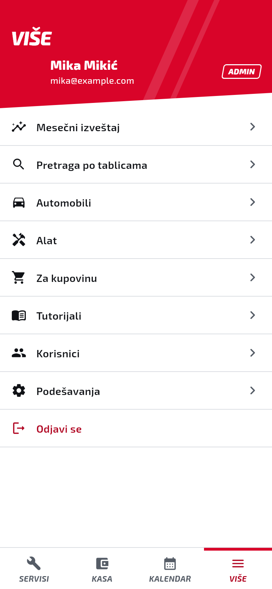

# Shell: the four tabs, the bottom bar and the Više tab

Code: `lib/screens/home_screen.dart`, `lib/screens/more_tab.dart`,
`lib/widgets/race_nav_bar.dart`.

## Purpose

The frame the app lives in after sign-in. It holds four tabs and the bar that
switches between them. Three tabs are screens of their own: Services, Wallet
and Calendar. The fourth, Više, lists every destination that has no tab. The
shell also owns the live data that every screen reads, the update check and
the calendar pushes.

**Opens from:** `ProfileGate`, once the account has a profile and is not
disabled.

## What it shows

From top to bottom:

1. **The open tab.** Each tab draws its own header, right up to the top of
   the screen; the shell has no app bar of its own.
   - [Services](services.md)
   - [Wallet](wallet.md)
   - [Calendar](calendar.md)
   - Više, described below
2. **Sync banner**, between the tab and the bottom bar (see
   [shared.md](../shared.md)).
3. **Bottom bar** with four items, each an icon over its label. The labels
   are shown in capitals:
   - "Servisi", a wrench icon
   - "Kasa", a wallet icon
   - "Kalendar", a calendar icon
   - "Više", a menu icon

The app opens on Services.

## The Više tab

1. **Header:** the title "Više" (shown in capitals), and inside the block the
   app logo, the user's full name, the email, and a leaning tag with the
   role: "Admin" or "Korisnik" (shown in capitals).
2. **Rows**, in this order, each with an icon on the left and a chevron on
   the right:

   | # | Row | Icon | Who sees it |
   |---|---|---|---|
   | 1 | "Mesečni izveštaj" | chart line | everyone |
   | 2 | "Pretraga po tablicama" | magnifier | everyone |
   | 3 | "Automobili" | car | everyone |
   | 4 | "Alat" | tools | everyone |
   | 5 | "Za kupovinu" | cart | everyone |
   | 6 | "Tutorijali" | book | everyone |
   | 7 | "Korisnici" | people | **admin only** |
   | 8 | "Podešavanja" | gear | everyone |
   | 9 | "Odjavi se" | exit | everyone; in the accent color, no chevron |

## Actions

| Tap | Result |
|---|---|
| A bottom bar item | switches the tab |
| "Mesečni izveštaj" | [report](monthly-report.md) |
| "Pretraga po tablicama" | [vehicle search](vehicles.md) |
| "Automobili" | [vehicles](vehicles.md) |
| "Alat" | [tools](tools.md) |
| "Za kupovinu" | [to-buy list](to-buy.md) |
| "Tutorijali" | [tutorials](tutorials.md) |
| "Korisnici" | [users](users.md) |
| "Podešavanja" | [settings](settings.md) |
| "Odjavi se" | signs out, back to login |

Every screen opened from a row is pushed on top of the shell, covers the
bottom bar and has a back arrow in its header.

Switching tabs builds the tab anew: the Services filters are cleared, the
wallet is back on the current month and the calendar on today.

## Dialogs and messages it shows

- **Update dialog**, when a newer version exists: on start and when a release
  push arrives. Never a second one on top of an open one. See
  [shared.md](../shared.md).
- **Booking push snack bar**, when a calendar push arrives while the app is
  open. See [shared.md](../shared.md).

## States

- **Loading, on Services and Wallet:** a centered spinner in place of the
  whole tab, header included, until cars, services, users and wallet entries
  have all arrived.
- **Error before anything loaded, on Services and Wallet:** the error text,
  centered.
- **Calendar and Više do not wait** for those collections. The calendar shows
  its own spinner or error under its header; Više needs no data.
- Tools, tutorials and the to-buy list are not waited for here either; their
  own screens show a spinner or an error.

## Layout today

- Bottom bar: 60 high above the system's bottom inset, on the `background`
  color, with a hairline on top. Four items of equal width. Each has a 4 px
  bar across its top, in `primary` on the open tab and invisible on the
  others; an icon of 22; 2; the label in 11.5 italic w700. The open tab's
  icon and label are in `accentText`, the others in `muted`.
- Više header: the title bar, then a row with the logo 44×44 (radius 8); 12;
  the name in 18 w800 over the email in 13, each on one line; 8; the role tag
  with its outline and text in `onPrimary`.
- Više rows: 54 high, 16 at the sides, a hairline under each. Icon 22; 14;
  the label in 15 w600 on one line; a chevron in `muted`. "Odjavi se" has its
  icon and label in `accentText` and no chevron. The list has 16 under the
  last row.
