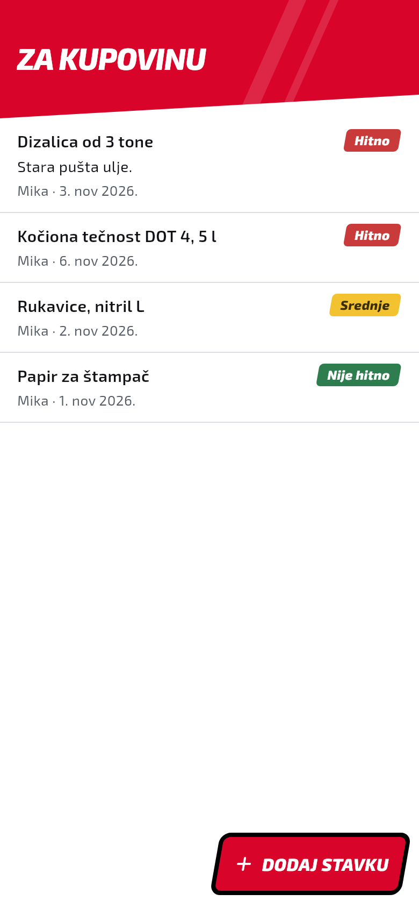

# To buy

Code: `lib/screens/planned_purchases_screen.dart`,
`lib/widgets/planned_purchase_card.dart`,
`lib/widgets/planned_purchase_dialog.dart`,
`lib/widgets/purchase_priority.dart`, `lib/models/planned_purchase.dart`.

## Purpose

What the workshop still has to buy, each with how urgent it is. A shared
list: anyone may add an item, correct it, or take off what was bought.

**Opens from:** "Za kupovinu" on the [Više tab](shell.md).

## What it shows

Header: "Za kupovinu" (shown in capitals), with a back arrow. Under it, the
sync banner.

1. One **row per item**, in one flat list with no headings:
   - the name of the thing;
   - beside it, on the right, its **priority as a leaning colored label**:
     "Hitno" in red, "Srednje" in yellow, "Nije hitno" in green;
   - the note, up to 3 lines, when it has one;
   - who added it · when.
2. **Floating button:** "Dodaj stavku" (shown in capitals).

Order: urgent first, then medium, then not urgent. Within a priority, whatever
has waited longest comes first, and an item still being saved comes last.

## Actions

| Tap | Result |
|---|---|
| A row | the item dialog for it |
| "Dodaj stavku" | the item dialog, empty |

## Dialogs

**Item dialog.** Title "Nova stavka" or "Izmena stavke"; a delete icon
(tooltip "Obriši") in the title row when editing.

- "Šta treba kupiti", hint "npr. dizalica od 3 tone", required ("Obavezno"),
  up to 100 characters. The cursor starts here for a new item.
- "Prioritet": three rows, one under another, in this order: "Hitno",
  "Srednje", "Nije hitno". Each has a round mark in its color with its own
  sign (an exclamation mark, two bars, a down arrow), so they can be told
  apart without the colors. The chosen row is ticked. A new item starts on
  "Srednje".
- "Napomena", 1 to 4 lines, hint "npr. gde se kupuje, koji model", up to 500
  characters.
- When editing: "Uneo/la: {name}".
- Buttons "Otkaži" / "Sačuvaj".
- Delete asks "Obrisati ovo sa spiska?".

Whoever edits an item, the one who added it stays on record.

## States

- **Loading:** a spinner. **Error:** the error text, padding 48/24.
- **Empty:** "Još nema ničeg za kupovinu.\nDodirni dugme ispod da dodaš prvu
  stavku."

## Layout today

- The list has no side padding and 96 at the bottom; rows touch.
- Row: edge to edge with a hairline under it, padding 16, 10, 18, 10. The
  name in 15 w600, as many lines as it needs, with the label 10 to its right
  at the top; 3; the note in 14; 4; "author · date" in 13 `muted`.
- Priority label: leaning 10°, radius 4, padding 9×2, text 12 w800, not in
  capitals. Red `#C93A3A` with white text, yellow `#F2C230` with `#3A2E00`
  text, green `#2E7D4F` with white text; the same in the light and the dark
  theme.
- In the dialog: 16 above "Prioritet", 12 above "Napomena", 12 above
  "Uneo/la". The "Prioritet" label is 13 w600 in `ink` at 0.65. Each row is a
  list tile with radius 8 and a round mark of radius 16; the chosen row has a
  `soft` fill at 60%, its name in w800 and a check icon in `primary`.
- Empty text: centered, padding 48/24.
