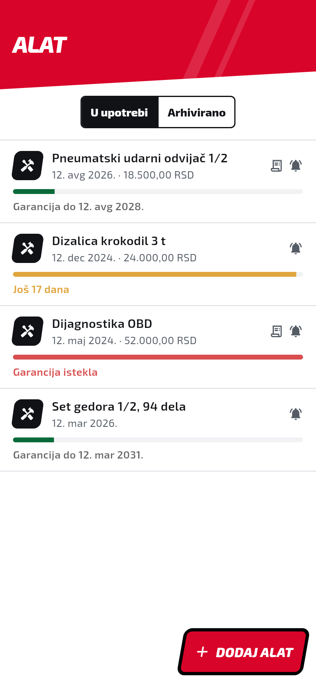

# Tools: the list, the form and the receipt

Code: `lib/screens/tools_screen.dart`, `lib/screens/tool_form_screen.dart`,
`lib/screens/receipt_screen.dart`, `lib/widgets/tool_card.dart`,
`lib/widgets/tool_fields.dart`, `lib/widgets/warranty_bar.dart`,
`lib/widgets/warranty_duration_field.dart`, `lib/widgets/receipt_field.dart`.

---

## Tools list

### Purpose

Everything the workshop owns that is not consumable, with its warranty. A
shared record: anyone may add and correct a tool. A tool is archived, never
deleted.

**Opens from:** "Alat" on the [Više tab](shell.md).

### What it shows

Header: "Alat" (shown in capitals), with a back arrow. Under it, the sync
banner.

1. A segmented switch **"U upotrebi" | "Arhivirano"**. It stays in place
   while the list scrolls.
2. One **tool row** per tool on the chosen side, newest purchase first:
   - a leaning dark block with a tool icon;
   - the name, up to 2 lines;
   - a meta line: purchase date · price · "Arhivirano". The price shows only
     when known, "Arhivirano" only on an archived tool;
   - small icons at the right end: a receipt icon when there is a receipt, a
     bell when the expiry reminder is on (not on archived tools);
   - the **warranty bar** with its label: "Garancija do {date}", "Još N dana",
     "Garancija ističe danas" or "Garancija istekla". A warranty that still
     runs is green, one that ends soon amber, an expired one red.
3. **Floating button:** "Dodaj alat" (shown in capitals).

In the picture a hairline runs under the segmented switch. The screen has
none there; the first hairline is the one under the first row.

### Actions

| Tap | Result |
|---|---|
| "U upotrebi" / "Arhivirano" | which tools are listed |
| A tool row | the tool form for it |
| "Dodaj alat" | an empty tool form |

### States

- **Loading:** a spinner. **Error:** the error text, padding 48/24.
- **Empty:** "Još nema alata." On "U upotrebi" also: "Alat se obično doda pri
  trošku iz kase, ili dugmetom ispod."

### Layout today

- From the top: the header, the sync banner, the segmented switch (centered,
  padding 16, 4, 16, 10, no check icon), the list. The list has no side
  padding and 96 at the bottom; rows touch.
- Tool row: edge to edge with a hairline under it, padding 16, 10, 16, 10.
  The block is 36×36 with an 18 px icon; 12; the name in 15 w600; 2; the meta
  line in 13 `muted`; the small icons are 18 px in `muted`, 6 apart.
- 8 above the warranty bar: 6 px tall, radius 6, `panel` track; 6; the label
  in 13 w600. Running: the bar in `moneyIn`, the label in `ink` at 0.65.
  Ending soon: both amber `#E0A63E`. Expired: both red `#D94E4E`.

---

## Tool form

### Purpose

Enter a tool, or change or archive one.

**Opens from:** "Dodaj alat"; a tool row; the tool's row on a
[wallet spending](wallet.md).

### What it shows

Header: "Novi alat" or "Izmena alata" (shown in capitals), with a back arrow.
When editing, one action icon: an archive icon with the tooltip "Arhiviraj",
or on an archived tool an unarchive icon with the tooltip "Vrati iz arhive".

1. When editing: a person icon and "Uneo/la: {name}".
2. **"Vrsta alata"**, with a tool icon, hint "npr. udarni odvijač", required.
3. **"Garancija"**: a number field and the switch "Meseci" | "Godine". The
   helper text is "Garancija do {date}", or the rule: "Od 1 do 12 meseci, duže
   se unosi u godinama" / "Najmanje 1 godina".
4. The **receipt card**: "Dodaj račun" with "Slika, da ti je pri ruci kad ideš
   na reklamaciju.", or "Račun" with a thumbnail. Hidden in a build without
   the upload settings.
5. The switch **"Podseti pre isteka"**, with "30 dana pre, i dan pred istek."
   under it.
6. **"Datum kupovine"**, a date field with the month written out.
7. One of two:
   - A tool not bought through the wallet: on one line, **"Iznos"** with the
     helper "Neobavezno, kad nema troška u kasi", and the two currency
     buttons "RSD" and "EUR".
   - A tool bought through the wallet: a card with a wallet icon, the amount,
     "Otvori trošak u kasi" under it and a chevron.
8. **"Sačuvaj"** (shown in capitals, with a check icon).

### Actions

| Tap | Result |
|---|---|
| The receipt card, no photo | a sheet with "Slikaj" and "Izaberi iz galerije" |
| The receipt card, with a photo | the receipt screen |
| The edit / delete icons on the receipt card | replace / remove the photo |
| The wallet card | the [wallet entry](wallet.md) that paid for the tool |
| The archive icon | asks "Arhivirati {name}?" with "Nestaje iz liste. Trošak ostaje u kasi.", buttons "Otkaži" / "Arhiviraj"; then closes the form |
| The unarchive icon | puts the tool back among those in use and closes the form |
| "Sačuvaj" | checks the fields, closes the form, saves in the background |

Anyone may change any tool. Who entered it stays on record.

### States

- **Uploading a receipt:** a spinner on the card and "Šaljem sliku...".

### Layout today

- List padding 16.
- 14 under the author line; 14 between the name, the warranty row and the
  receipt card; 12 between the receipt card and the reminder switch. In the
  warranty row the number field and the segmented switch are 10 apart.
- "Podseti pre isteka" is a boxed row with the leaning switch at its right
  end.
- 6 above "Datum kupovine"; 14 above the amount or the wallet card; 20 above
  "Sačuvaj".
- The amount and the currency share their line: the field takes the width
  that is left; 12; the two currency buttons, 54×44 each, 6 apart.
- Receipt card and wallet card: cards with a hairline border and radius 10.
  The receipt card has a 40×40 thumbnail with radius 8, or a round `soft`
  avatar with a receipt icon in `primary`.
- "Sačuvaj" is the leaning button, 52 high, label 18, with 6 kept free at
  each end.

---

## Receipt screen

### Purpose

The photo of a receipt, full screen, to read and to share.

**Opens from:** a receipt card that has a photo.

### What it shows

- A black screen with a black app bar: a back arrow and the title "Račun".
- One action: a share icon, tooltip "Podeli".
- The photo, filling the screen.

### Actions

| Gesture | Result |
|---|---|
| Pinch | zooms the photo, up to 10× |
| Share icon | the phone's share sheet with the photo; the icon is a spinner meanwhile |

### States

- **Loading:** a spinner.
- **The photo cannot be loaded:** a broken-image icon, 48 px, white at 70%.

### Layout today

- This screen has the plain app bar, not the slanted header: black, with
  white icons. The title is in 24 italic w800 and takes the theme's color for
  text on the accent, `onPrimary`: white in five palettes, and `#101216` on
  the black bar in the yellow palette.
- The zoom area fills the screen whatever the shape of the photo.
- The share spinner is 20 px, white.
