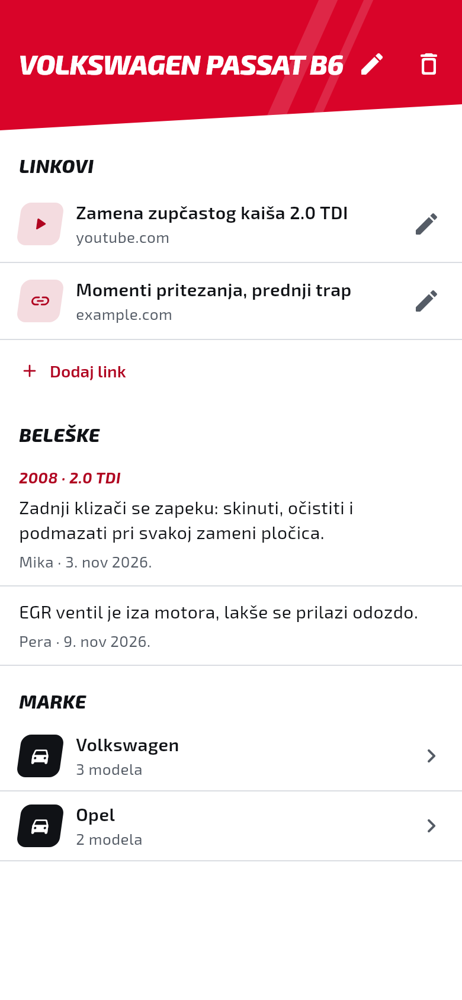

# Tutorials: makes, models, links and notes

Code: `lib/screens/tutorials_screen.dart`,
`lib/screens/tutorial_brand_screen.dart`,
`lib/screens/tutorial_model_screen.dart`,
`lib/screens/tutorial_model_form_screen.dart`,
`lib/widgets/tutorial_cards.dart`, `lib/widgets/tutorial_link_dialog.dart`,
`lib/widgets/tutorial_note_dialog.dart`, `lib/widgets/link_fields.dart`,
`lib/widgets/note_fields.dart`, `lib/widgets/name_dialog.dart`.

The workshop's shared knowledge, three levels deep: a make, its models, and
for each model links and notes. Anyone may add, correct or delete any of it;
who added a thing stays on record.

The picture puts two screens together. The header, "Linkovi" and "Beleške"
are the screen of one model. The two rows at the bottom are rows of the list
of makes; the heading "Marke" over them exists only in the picture.

---

## Makes

### Purpose

The list of makes.

**Opens from:** "Tutorijali" on the [Više tab](shell.md).

### What it shows

Header: "Tutorijali" (shown in capitals), with a back arrow. Under it, the
sync banner.

1. One row per make, sorted by name: a leaning dark block with a car icon,
   the name, the number of models under it ("3 modela"), a chevron.
2. **Floating button:** "Dodaj marku" (shown in capitals).

### Actions

| Tap | Result |
|---|---|
| A make | that make's screen |
| "Dodaj marku" | the name dialog: title "Nova marka", field "Marka", hint "npr. Volkswagen" |

A name that exists already is refused with "Ta marka već postoji".

### States

- **Loading:** a spinner. **Error:** the error text, padding 48/24.
- **Empty:** "Još nema marki.\nDodaj prvu, pa onda njene modele."

### Layout today

- The list has no side padding and 96 at the bottom; rows touch.
- Row: a RaceRow (see [shared.md](../shared.md)): at least 54 high, a 36×36
  block, the name in 15 w600, the count in 13 `muted`, a chevron in `muted`
  8 from the edge.
- Empty text: centered, padding 48/24.

---

## One make

### Purpose

The models of one make.

**Opens from:** a make's row.

### What it shows

Header: the make's name (shown in capitals), with a back arrow; actions: edit
(tooltip "Izmeni") and delete (tooltip "Obriši").

1. One row per model, sorted by name: a leaning dark block with a book icon,
   the name, and under it the counts of links and notes ("2 linka · 1
   beleška"), a chevron.
2. **Floating button:** "Dodaj model" (shown in capitals).

This screen has no sync banner.

### Actions

| Tap | Result |
|---|---|
| A model | that model's screen |
| "Dodaj model" | the new-model form |
| Edit | the name dialog: title "Izmena marke", field "Marka" |
| Delete | asks "Obrisati {name}?" |

A make that still has models cannot be deleted; a snack bar says "Prvo obriši
njene modele."

### States

- **Empty:** "Još nema modela."
- **The make was deleted while this was open:** a header with no title and
  "Obrisano", centered.

### Layout today

- As the list of makes. Empty text: padding 48/24.

---

## New model

### Purpose

Add a model, with its first links in the same step.

**Opens from:** "Dodaj model" on a make's screen.

### What it shows

Header: "{make} · Novi model" (shown in capitals), with a back arrow.

1. **"Model"**, hint "npr. Passat", up to 100 characters; the cursor starts
   here. Errors: "Obavezno", "Taj model već postoji".
2. The heading **"Linkovi"** (shown in capitals).
3. One card per link, each with "Naziv" and "Adresa". A row left blank is
   ignored. With more than one row, each has a close icon (tooltip "Ukloni").
4. A text button **"Dodaj još jedan link"**.
5. **"Sačuvaj"** (shown in capitals, with a check icon).

### Actions

| Tap | Result |
|---|---|
| "Dodaj još jedan link" | another empty link card |
| The close icon on a card | removes that row |
| "Sačuvaj" | checks the fields, closes the form, saves the model and its links in the background |

### Layout today

- List padding 16, 16, 16, 32.
- Heading: 16 italic w800, 18 above and 6 under, no side padding of its own.
- Link card: a card with a hairline border and radius 10, padding
  16, 8, 8, 16; the two fields 10 apart; cards 8 apart.
- "Dodaj još jedan link" is a left-aligned text button with a plus.
- 16 above "Sačuvaj", the leaning button, 52 high, label 18, with 6 kept
  free at each end.

---

## One model

### Purpose

Everything known about working on one model: links to follow and notes to
read.

**Opens from:** a model's row.

### What it shows

Header: "{make} {model}" (shown in capitals), with a back arrow; actions:
edit (tooltip "Izmeni") and delete (tooltip "Obriši").

1. The heading **"Linkovi"** (shown in capitals).
2. One row per link: a leaning block tinted with the accent, holding a play
   icon for a video link and a link icon otherwise; the title (up to 2
   lines); the website's host under it; and an edit icon (tooltip "Izmeni")
   on the right.
3. A text button **"Dodaj link"**.
4. The heading **"Beleške"** (shown in capitals).
5. One row per note: an optional line with the year and the engine, the
   text, then who wrote it and when.
6. A text button **"Dodaj belešku"**.

There is no floating button and no sync banner on this screen.

### Actions

| Tap | Result |
|---|---|
| A link row | opens the address outside the app |
| The edit icon on a link | the link dialog |
| "Dodaj link" | the link dialog, empty |
| A note row | the note dialog |
| "Dodaj belešku" | the note dialog, empty |
| Edit in the header | the name dialog: title "Izmena modela", field "Model", hint "npr. Passat" |
| Delete in the header | asks "Obrisati {name}?" with "Brišu se i njegovi linkovi i beleške." |

A link that cannot be opened gives the snack bar "Link ne može da se otvori."
Renaming to a name that exists is refused with "Taj model već postoji".

### Dialogs

**Link dialog.** Title "Novi link" or "Link"; a delete icon in the title row
when editing.

- "Naziv", hint "npr. Zamena kvačila", up to 100 characters.
- "Adresa", with a link icon, hint "youtube.com/…". Errors: "Obavezno",
  "Unesi ispravnu web adresu".
- When editing: "Uneo/la: {name}".
- Buttons "Otkaži" / "Sačuvaj". Delete asks "Obrisati ovaj link?".

**Note dialog.** Title "Nova beleška" or "Beleška"; a delete icon when editing.

- "Godište", hint "npr. 2016 ili 2013-2016", up to 20 characters.
- "Motor", hint "npr. 2.0 TDI", up to 50 characters.
- "Beleška", 3 to 8 lines, required, up to 2000 characters, hint "Šta je
  dobro znati sledeći put".
- When editing: "Uneo/la: {name}".
- Buttons "Otkaži" / "Sačuvaj". Delete asks "Obrisati ovu belešku?".

### States

- **No links:** "Još nema linkova." **No notes:** "Još nema beleški."
- **The model was deleted while this was open:** a header with no title and
  "Obrisano", centered.

### Layout today

- One scrolling list with no side padding and 32 at the bottom.
- Headings: 16 italic w800, padding 16, 18, 16, 6. The empty texts have
  padding 16, 4, 16, 8.
- Link row: a RaceRow with a hairline under it. The block is 36×36, a 14%
  tint of `accentText` with the icon in `accentText`; 12; the title in 15
  w600; the host in 13 `muted` on one line; the edit icon button at the
  right end.
- Note row: edge to edge with a hairline under it, padding 16, 10, 16, 10;
  the year/engine line in 13 italic w700, `accentText`; 4; the text in 15,
  as many lines as it needs; 6; "author · date" in 13 `muted`.
- The two "Dodaj…" buttons are left-aligned text buttons with a plus, 4 from
  the left edge and 2 under the last row.
- In the dialogs the fields are 10 apart, and "Uneo/la" sits 12 under them.
