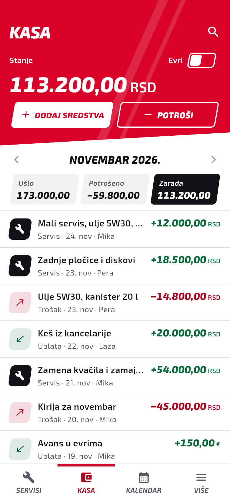
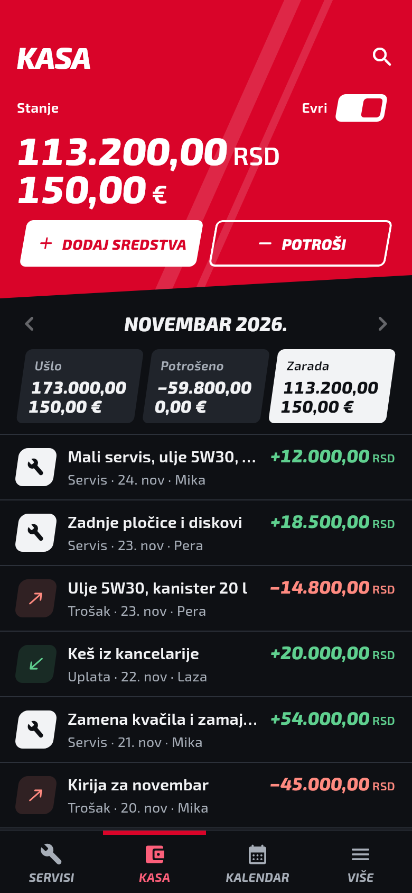
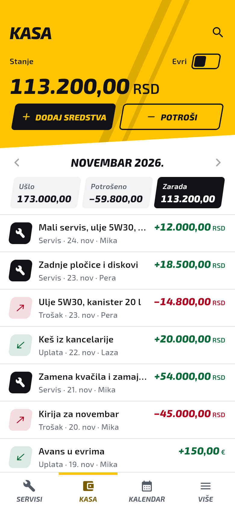

# Wallet: the tab and the entry form

Code: `lib/screens/wallet_tab.dart`, `lib/screens/wallet_entry_screen.dart`,
`lib/widgets/balance_card.dart`, `lib/widgets/wallet_history.dart`,
`lib/widgets/wallet_month_summary.dart`, `lib/widgets/movement_tile.dart`,
`lib/widgets/shortfall_dialog.dart`, `lib/widgets/spending_tool_section.dart`,
`lib/services/euro_visibility.dart`.

---

## Wallet tab

### Purpose

The shared cash box: what is in it now, and what came in and went out, one
month at a time.

**Opens from:** the shell's second tab; "Kasa" in the bottom bar.

### What it shows

1. **Header:**
   - the title "Kasa" (shown in capitals) and a search icon, tooltip
     "Pretraga po tablicama";
   - "Stanje" on the left; on the right "Evri" with a switch;
   - the balance in dinars. With "Evri" on, the balance in euros under it.
     A negative balance is shown in another color;
   - two buttons: "Dodaj sredstva" (+) and "Potroši" (−), both shown in
     capitals.
2. **Month switcher**: the month's name between two arrows. It starts at the
   current month and goes back to the month of the oldest movement.
3. **The month's sums**, three leaning tiles side by side:
   - "Ušlo": what came into the wallet that month.
   - "Potrošeno": what was spent, with a minus.
   - "Zarada": the first less the second, as the dark tile; the tile turns
     red when the result is negative.
   - Dinars are the bare number, without "RSD". With "Evri" on, each tile has
     a second line in euros, with "€".
4. **One row per movement** of that month, newest first. See "Movement row".

The balance always covers every month. The sums and the list cover the month
shown. The sums count only money that passed through the wallet: a service
whose money did not go into the wallet, or one with no charge, is not in them.

### Actions

| Tap | Result |
|---|---|
| Search icon | opens [vehicle search](vehicles.md) |
| "Evri" or its switch | shows or hides euros in the balance and in the month's sums |
| "Dodaj sredstva" | the entry form for a deposit |
| "Potroši" | the entry form for spending |
| The arrows | the month before / after; disabled at the oldest month and at the current one |
| A service row | the [service form](services.md) for that service |
| A deposit or spending row | the entry form for it: editable for its author and the admin, read-only for others |

"Evri" is kept on the phone and starts off. While it is off, euros are not
shown in the balance or the sums even when the wallet holds some. Euro
movements stay on the list either way.

Leaving the tab and coming back returns to the current month.

### States

- **Empty wallet:** "Još nema promena u kasi.", with no month switcher and no
  sums.
- **A month with nothing in it:** "U ovom mesecu nije bilo promena u kasi.",
  with the switcher but no sums.
- Loading and errors are handled by the [shell](shell.md).

### Layout today

- From the top: the header, then one scrolling list with the switcher, the
  tiles, a hairline and the rows. The list has no side padding and 32 at the
  bottom.
- Header, under the title bar: "Stanje" and "Evri" in 13 w600; the switch is
  drawn in `onPrimary`. The balance in 36 italic w800 with the currency
  smaller after it, one line per currency, shrinking to fit. Everything is in
  `onPrimary`; a negative balance is amber `#FFD166`, or `moneyOut` in the
  yellow palette, whose text on the accent is dark.
- 12 above the buttons. They share the row equally, 12 apart, with 6 kept
  free at each end; each at least 44 high. "Dodaj sredstva" is filled with
  `onPrimary` and written in `primary`; "Potroši" is a 2 px outline in
  `onPrimary`.
- Switcher: 4 at the sides.
- Tiles: 20 at the sides, 8 apart, equal widths and heights. Each leans 8°,
  radius 6, padding 10, 7, 10, 8: the label in 12 w600, 2, then the figures
  in 16 w800, shrinking to fit. "Ušlo" and "Potrošeno" are `panel` with `ink`
  figures and a `muted` label; "Zarada" is `ink` with `background` text, or
  `moneyOut` with `background` text when the month is in the red.
- 10 under the tiles, then a hairline, then the rows.
- Empty-state text: centered, padding 48 vertical, 24 horizontal.

---

## Movement row

One line of the wallet's history.

### What it shows

- A leaning block with an icon: a wrench for a service, an arrow pointing
  down-left for a deposit, an arrow pointing up-right for spending.
- The description on one line; several lines are joined with commas, as on a
  service row. Without a description, the kind stands in its place.
- On the right: the amount with "+" before it, in green, or with "−" before
  it, in red: "+12.000,00 RSD", "−14.800,00 RSD".
- Under them: kind · date · person. The kind is "Servis", "Uplata" or
  "Trošak"; the date is the day and the short month, such as "24. nov".

### Layout today

- Edge to edge with a hairline under it; padding 16 at the sides, 9 above
  and below.
- Block: 36×36, radius 8, leaning 8°, icon 18. A service has the dark block;
  a deposit a 14% tint of `moneyIn` with the icon in `moneyIn`; spending the
  same in `moneyOut`.
- 12; the description in 15 w600, cut with an ellipsis; 10; the amount in 17
  italic w800 with the currency smaller after it, all in `moneyIn` or
  `moneyOut`.
- 3; the line under in 13 `muted`, on one line.

---

## Wallet entry form

### Purpose

Add money to the wallet or record spending, or view, change or delete one.

**Opens from:** "Dodaj sredstva" and "Potroši" in the wallet's header; a
deposit or spending row; the tool form's "Otvori trošak u kasi".

### What it shows

Header: "Dodavanje sredstava" (new deposit), "Trošak iz kase" (new spending)
or "Izmena stavke" (an existing one), shown in capitals, with a back arrow; a
delete icon (tooltip "Obriši") for an existing entry its viewer may change.

1. For someone who may only look: "Ovo mogu da menjaju samo {name} ili admin."
2. On one line: **"Iznos"**, a number field, and the two currency buttons
   **"RSD"** and **"EUR"**. For spending the helper text under the field is
   "Na raspolaganju: {amount}", what the wallet holds in the chosen currency.
3. A description field, 2 to 4 lines:
   - spending: "Na šta je potrošeno", required;
   - deposit: "Napomena", hint "npr. keš iz kancelarije", optional.
4. **"Datum"**, a date field with the month written out.
5. A person picker: "Ko je potrošio" (spending) or "Ko je dodao" (deposit).
6. **Spending only, the tool section:**
   - New spending: the switch "Dodaj u alat", with "Sve što nije potrošno je
     alat." under it. When on, the tool fields appear (see [tools](tools.md)):
     "Vrsta alata", the warranty, the receipt and "Podseti pre isteka".
   - Existing spending that bought a tool: that tool's row.
7. **"Sačuvaj"** (shown in capitals, with a check icon), for whoever may
   change it.

### Actions

| Tap | Result |
|---|---|
| "RSD" / "EUR" | chooses the currency; for spending the helper text follows |
| The person picker | option sheet of users, each with the email under the name |
| "Dodaj u alat" on | the tool fields appear; saving records the spending and the tool together |
| The tool's row | opens the [tool form](tools.md) |
| "Sačuvaj" | checks the fields, closes the form, saves in the background |
| Delete icon | asks "Obrisati ovu stavku?", then closes and deletes |

Who may change: the author and the admin.

### Dialogs and messages

- **Not enough money**, when spending would take the currency below zero: a
  wallet icon, "Nema dovoljno sredstava u kasi", the body "Na raspolaganju je
  {available}, a ovaj trošak je {amount}. Kasa ne može da ide u minus.", and
  "Zatvori". The form stays open.
- **Spending that bought a tool cannot be deleted:** a snack bar, "Ovaj trošak
  je kupio alat, pa ne može da se obriše."

### States

- **Read-only:** fields disabled, the notice on top, no "Sačuvaj", no delete
  icon, no "Na raspolaganju" line.

### Layout today

- List padding 16; fields 14 apart; 24 above "Sačuvaj".
- The amount and the currency: the field takes the width that is left; 12;
  the two currency buttons, 54×44 each, 6 apart.
- "Dodaj u alat" is a boxed row with the leaning switch at its right end. It
  sits 12 under the person picker. When on, the tool
  fields start 12 under it.
- The tool's row sits 14 under the person picker.
- "Sačuvaj" is the leaning button, 52 high, label 18, with 6 kept free at
  each end.
- The not-enough-money dialog has a 36 px icon above its title.
