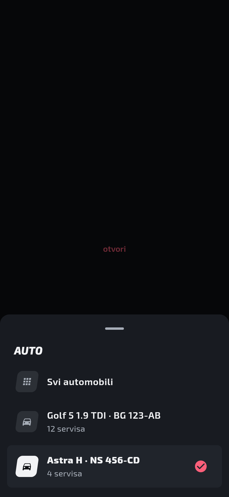

# Shared pieces

Widgets and patterns that more than one screen uses. All are in
`lib/widgets/`. See [look.md](look.md) for the colors and the theme; color
names such as `ink`, `muted`, `panel` and `line` are explained there.

## Saving, as the user sees it

- Tapping "Sačuvaj" or confirming a delete closes the screen or dialog **at
  once**. Nothing waits for the server, so it works offline too.
- The **sync banner** then shows "Sinhronizujem..." and, when the write has
  reached the server, "Sinhronizovano".
- A write that fails comes back as a **snack bar** with the reason, on whatever
  screen is open by then.
- Two screens do wait for an answer, because they cannot go on without it:
  the admin claim and adding a user. Their button reads "Sačekaj..." meanwhile.

## SyncBanner (`sync_banner.dart`)

A full-width strip.

- On the four tabs the shell draws it between the open tab and the bottom
  bar.
- Screens pushed on top of the shell that show lists draw their own, directly
  under the header: report, vehicles, tools, to-buy, tutorials (the list of
  makes) and users.
- The calendar screen also draws one under its header. It is a tab, so on the
  calendar the banner shows in both places at the same time.
- Syncing: blue `#3B82F6`, a 15 px white spinner, "Sinhronizujem...".
- Done: green `#22A06B`, a check icon, "Sinhronizovano".
- Text 13 w600, white. Padding 8/16. Slides open and closed in 220 ms; hidden
  when there is nothing to say.

## Header: SlantHeader and SlantAppBar (`slant_header.dart`)

The accent block that tops a screen. It reaches under the status bar.

- The title, shown in capitals: 28 italic w800, one line. A title that is too
  long shrinks to fit.
- An optional text after the title, shown in capitals, 14 italic w700; then
  the title takes at most 220 and is cut with an ellipsis. Only the Services
  tab uses it, for the month.
- A back arrow before the title whenever the screen can be left. The tabs
  have none.
- Action icons at the right end of the title bar, in `onPrimary`.
- Optionally a few lines of the screen's own content inside the block, under
  the title bar: the earnings on Services, the balance on the wallet, who is
  signed in on Više, the logo and tagline on the login screen.
- Two stripes and a bottom edge that is 22 lower on the left than on the
  right.
- The title bar is 52 high. Left padding 16 (4 when there is a back arrow),
  right 4; 30 from the content to the lowest point of the edge.
- `SlantAppBar` is the same block as a screen's app bar, for screens that put
  only the title and actions in it. It is 82 high plus the status bar.

Two screens have another app bar in its place: the vehicle search (the plain
app bar in the accent, with the search field as its title) and the receipt
screen (a black app bar). The admin claim and the status screen have no
header at all.

## Leaning controls (`skewed.dart`)

- **`Skewed`** leans whatever is inside it, text included: by 10° unless told
  8°.
- **`SkewButton`**: a leaning button with its label in capitals (14 w800) and
  an optional icon before it. Filled with the accent and written in
  `onPrimary`; or given other colors; or only a 2 px outline. At least 44
  high, radius 6. A label too long for it shrinks to fit. Disabled, it is
  drawn at half opacity.
- **`SkewFab`**: the floating button of a screen. A `SkewButton` 50 high with
  a 16 label, an icon and a lift of 4. The Services tab builds the same
  button directly.
- **`SkewSubmit`**: the button that ends a form. A `SkewButton` 52 high with
  an 18 label and a check icon, as wide as the form, with 6 kept free at each
  end. The login, the admin claim and the status screen use it without the
  icon. The service form builds the same button directly.
- **`SkewTag`**: a small leaning outlined label in capitals, 11 w800, in
  `muted` unless given a color. "Bez naplate" on a service row; the role on
  the Više tab.
- **`SkewSwitch`**: on or off, as a leaning box 46×26 with a square knob that
  sits right when on. On: filled with the accent, the knob in `onPrimary`.
  Off: an outline and a knob in `muted`. On an accent block it is drawn in
  `onPrimary` instead (the "Evri" switch).
- **`SkewSwitchTile`**: a boxed row (a hairline border, radius 8) with a
  title in w600, an optional line under it in 13 `muted`, and a `SkewSwitch`
  at the right end. Tapping anywhere on it flips the switch. Used for "Bez
  naplate", "Dodaj iznos u kasu", "Dodaj u alat" and "Podseti pre isteka".
- **`SkewIcon`**: a leaning block 36×36 (radius 8, leaning 8°) with an 18 px
  icon, to lead a row. Without a color it is the dark block; with one, a 14%
  tint of that color with the icon in it.

## RaceRow (`race_row.dart`)

One row of a list, edge to edge, with a hairline under it.

- Something leading (usually a `SkewIcon`), then 12.
- A title in 15 w600, one line unless told more.
- Under it either a line of text in 13 `muted`, or a widget where text will
  not do (a plate with a name beside it).
- Optionally something that ends the row: a chevron, icon buttons, a text
  button.
- At least 54 high. Padding 16, 8, 16, 8; the right padding is 6 when
  something ends the row.
- Used for vehicles, search results, users, makes, models and links. The
  service row, the wallet row, the tool row, the note row, the to-buy row and
  the booking row are built on their own but follow the same pattern: edge to
  edge, 16 at the sides, a hairline under.

## PlateChip (`plate_chip.dart`)

A registration plate, drawn as one: a `surface` box with a 1.5 px border in
`ink`, radius 4, the plate in 12 w800. Used on service rows and the vehicles
list (12), in search results (13) and at the top of a car's history (18).

## DateBlock (`date_block.dart`)

A day as a leaning dark block, 44×44, radius 8: the day number in 19 w800
over the short month in capitals in 11 w600 ("24" over "NOV"). Leads every
service row.

## MoneyText (in `repair_card.dart`)

An amount as leaning figures: the number in 17 italic w800 with the currency
after it at 65% of the size, w600 and upright. The number is `ink` and the
currency `muted`, unless one color is given for both. Digits are of equal
width, so amounts line up. Used on service rows, on wallet rows (with "+" or
"−" before the amount, in `moneyIn` or `moneyOut`) and for the balance (36).

## RaceNavBar (`race_nav_bar.dart`)

The bottom bar of the shell: one item per tab, each an icon (22) over its
label in capitals (11.5 italic w700). The open tab is in `accentText` with a
4 px bar in `primary` across its top; the others are `muted`. 60 high, with a
hairline on top.

## SectionTitle and TutorialsLoading (in `tutorial_cards.dart`)

- **`SectionTitle`**: a heading inside a list, shown in capitals, 16 italic
  w800, padding 16, 18, 16, 6 (no side padding inside a form). "Linkovi" and
  "Beleške" in Tutorials, "Servisi" in the report.
- **`TutorialsLoading`**: what a screen shows while its data is not here yet:
  a centered spinner, or the error text (padding 48/24) when loading failed.
  Used by the tutorials screens and the to-buy list.

## Option sheet (`option_sheet.dart`)

A bottom sheet for picking one of several: top corners 16, a drag handle, the
title in capitals in 18 italic w800. At most 70% of the screen high; the rows
scroll.

- One row per option: radius 8, a `SkewIcon` with the sheet's icon, a label
  in w600 and an optional line under it.
- An optional first row for "all", with an apps icon.
- The chosen row has a `panel` fill, the dark block as its icon, its label in
  w800 and a check icon in `accentText`. The other rows have a `muted` tint
  as their icon block.
- Used by the filter button and the picker field.

## Filter pill (`filter_pill.dart`)

A leaning filter button. Used on the Services tab only, for the car and the
person.

- Shows an 18 px icon, the chosen value in w600 (or the "all" label) on one
  line, and a down arrow. 44 high, radius 6, a 2 px border in `ink`.
- No filter: `surface` fill, content in `ink`.
- A filter is on: `ink` fill, content in `background`, and an **x** in place
  of the arrow. The x clears the filter; the rest of the button opens the
  sheet.
- Opens an option sheet with an "all" row.

## Picker field (`picker_field.dart`)

A form field that looks like the text fields but opens an option sheet: label,
leading icon, the chosen value on one line, a down arrow. The sheet's title
is the field's label. Used for the car on the service form and the person on
the wallet entry form.

## Date field (`date_field.dart`)

A read-only field with a calendar icon that opens the date picker. Shows the
date with the month written out ("25. novembar 2026."). With `compact` it
shows digits only ("25. 11. 2026."), for where the field is half as wide: the
service form, where the date shares its line with the mileage. Used on the
service form, the wallet entry form, the tool form and the booking dialog.

## Money fields (`money_fields.dart`)

The amount and its currency on one line.

- A number field "Iznos"; what is typed shows in 22 italic w800. Error:
  "Unesi iznos veći od 0". It may be made optional and given a helper text.
- 12 to its right, two leaning boxes, "RSD" and "EUR", 54×44 each and 6
  apart: the chosen one is `ink` with `background` text, the other `surface`
  with `ink` text; both have a 2 px border in `ink`.
- Used on the service form (inside the price fields), the wallet entry form
  and the tool form.

## MoneyRow (`money_row.dart`)

A label on the left with its amounts on the right, one line per currency.

- Normal row: 15 w600 in `ink`. A detail row ("od toga alat"): 13, `ink` at
  0.6, indented 16. The bottom line: 17 w800 in `ink`, or `moneyOut` where it
  is negative.
- A sign such as "− " goes before every amount except a zero.
- Used by the report: "Zarada od servisa", "Ostali prihodi", "Troškovi",
  "od toga alat", "Neto".

## Month switcher (`month_switcher.dart`)

"‹ NOVEMBAR 2026. ›": an arrow each side of the month's name, which is shown
in capitals (18 italic w800, centered). An arrow is disabled at the first and
at the last month it was given. Tooltips "Prethodni mesec" and "Sledeći
mesec". Used by the report, the wallet and the calendar.

## Confirm delete (`confirm_delete.dart`)

A yes/no dialog: the question as the title, an optional body, buttons "Otkaži"
and "Obriši" (or another confirm label, such as "Arhiviraj").

## Name dialog (`name_dialog.dart`)

A dialog with one text field, up to 100 characters, and "Otkaži" / "Sačuvaj".
Used for a make and a model in Tutorials.

## Name fields (`name_fields.dart`)

"Ime" and "Prezime", 12 apart, and the dialog "Izmeni ime" built from them.
Used on the admin claim, in the add-user dialog and in Settings.

## Receipt field (`receipt_field.dart`)

A card for the photo of a receipt, on the tool fields.

- No receipt: a round `soft` avatar with a receipt icon in `primary`, "Dodaj
  račun", and under it "Slika, da ti je pri ruci kad ideš na reklamaciju."
- With a receipt: a 40×40 thumbnail (radius 8), "Račun", and edit and delete
  icons for whoever may change it.
- Uploading: a spinner and "Šaljem sliku...".
- Tap: opens the receipt screen if there is a photo; otherwise a sheet with
  "Slikaj" and "Izaberi iz galerije".
- Hidden altogether in a build without the upload settings.

## Warranty bar (`warranty_bar.dart`) and duration field (`warranty_duration_field.dart`)

- **Bar:** a 6 px progress bar (radius 6, `panel` track) and a 13 w600 label
  under it. While the warranty runs the bar is `moneyIn` (green, not the
  accent) and the label "Garancija do {date}" is `ink` at 0.65. Near the end
  both are amber `#E0A63E`, with "Još N dana" or "Garancija ističe danas".
  Expired, both are red `#D94E4E`, with "Garancija istekla".
- **Duration field:** a number field "Garancija" with a shield icon and, 10
  to its right, a segmented switch "Meseci" | "Godine". The helper text shows
  "Garancija do {date}" or the rule that was broken: "Od 1 do 12 meseci, duže
  se unosi u godinama" / "Najmanje 1 godina".

## Totals card (`totals_card.dart`)

A leaning dark block (8°, radius 8), as wide as it is allowed: "Ukupno" in 12
w600, under it the sum per currency in 22 w800, and at the right end "N
servisa" in 13 w600. A sum too long for it shrinks to fit. Used at the top of
a car's history.

## Update dialog (`update_dialog.dart`) and tile (`update_tiles.dart`)

- **Dialog:** a 36 px update icon, "Dostupna je nova verzija", the body
  "Verzija {version} je spremna za preuzimanje. Ti imaš {current}.", buttons
  "Kasnije" and a filled "Preuzmi" (44 high) that opens the download link.
  Shown by the shell on start and when a release push arrives, and from
  Settings.
- **Tile:** "Proveri ažuriranja" with "Verzija {x}" under it, in Settings.

## Booking push snack bar (`appointment_push_snack_bar.dart`)

Shown by the shell when a calendar push arrives while the app is open: a bold
title ("Novo zakazivanje za {date}", "Sutra je zakazano, {date}" or
"Oslobođen termin za {date}") and up to 4 lines of the booking's text.

## Email field with saved emails (`email_autocomplete_field.dart`)

The email field on the login screen. Emails that signed in before are offered
in a popup (radius 8, at most 260 px tall): a history icon, the email, and an
x (tooltip "Obriši") that forgets it.

## Author line

Forms and dialogs that edit an existing record show who entered it: an 18 px
person icon and "Uneo/la: {name}", or, for someone who may only look,
"Ovo mogu da menjaju samo {name} ili admin.". The wallet entry form shows
only the second, without the icon; the to-buy, link and note dialogs show
only the first, without the icon.
